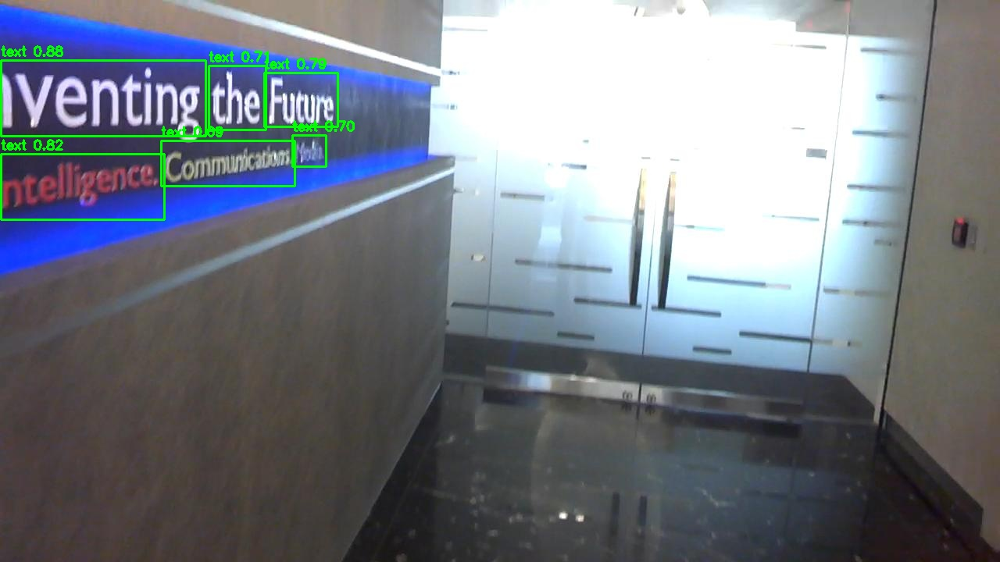

# AEGIS - Signboard Reader

**Make the words around you easier to notice.**

AEGIS is an experimental, camera-based assistant that reads signs and gives you a spoken, directional summary. It is designed to help people who have difficulty reading signs at a glance, especially when moving through unfamiliar public spaces, by turning visible text into timely audio and on-screen alerts.

Point a phone camera at the world. AEGIS looks for signboards, reads the text, and can tell you whether it appears to be on your left, ahead, or on your right. Ask what it can see, and it can summarize recently observed signs in a more natural way.

> **Prototype notice:** AEGIS is an assistive experiment, not a navigation system or a substitute for your own judgment. Do not rely on it to identify every hazard, read every sign correctly, or make safety-critical decisions. Detection and OCR quality depend on camera position, lighting, distance, and the sign itself.

## What it can do

- **Read signs in a live camera view.** The vision pipeline detects sign/text regions and applies OCR to read them.
- **Speak useful context.** Alerts can include a coarse direction (left, ahead, or right) and a rough visual distance hint. The distance is inferred from how large a sign appears in the image; it is **not** a measured range.
- **Bring important signs forward.** Common warnings and user-defined priorities, such as "wet floor" or "pharmacy," can trigger spoken alerts.
- **Let you ask about the scene.** Ask questions like "What do I see?" to hear a short summary of recently read signs.
- **Support voice and touch.** The Flutter app provides a live camera view, visual alerts, voice commands, and text input for commands.
- **Offer English and Hindi settings.** The app currently exposes English and Hindi for voice input and spoken output.

## A glimpse of sign detection

The image below shows an example of the vision model locating text regions in a camera frame. The full experience combines this visual detection with OCR, directional context, and spoken feedback.



## How the experience works

1. The phone camera sends frames to the assistant running on a computer on the same network.
2. A trained vision model finds likely sign or text regions; OCR extracts the visible words.
3. AEGIS relates each observation to its position in the frame and checks it against built-in and personal priorities.
4. The app displays the annotated camera view and alerts; speech output can read relevant information aloud.
5. You can ask what signs have been seen or use voice/text commands to manage your priorities.

The computer runs the vision and language components; the phone acts as the camera and interactive display. A local webcam mode is also available for trying the assistant without the Flutter camera stream.

## Try it

### You'll need

- A computer with Python **3.10 or 3.11**, and [Ollama](https://ollama.com/) installed.
- A phone or supported Flutter device with a camera and microphone.
- The computer and phone on the same Wi-Fi network for the default phone-camera setup.
- [Flutter](https://docs.flutter.dev/get-started/install) installed with a Dart SDK compatible with the app.

### 1. Prepare the assistant

From the project root, create and activate a virtual environment, then install the Python dependencies:

```powershell
py -3.11 -m venv .venv
.\.venv\Scripts\Activate.ps1
python -m pip install -r requirements.txt
```

Download the language model used by the assistant:

```powershell
ollama pull llama3.1:8b
```

Make sure Ollama is running. On systems where it is not already running as a service, start it in a separate terminal:

```powershell
ollama serve
```

### 2. Connect the phone app

Find the computer's local Wi-Fi/LAN IP address. In `signboard_app/lib/main.dart`, set `SERVER_IP` to that address. Keep the port at `8765` unless you also change the backend configuration.

Allow inbound connections to port `8765` through the computer’s firewall if prompted. The phone and computer need to be on the same network.

### 3. Start the assistant and app

In the project-root terminal, start the backend:

```powershell
python main.py
```

In a second terminal:

```powershell
cd signboard_app
flutter pub get
flutter run
```

Grant camera and microphone permissions when asked, then tap **Connect** in the app. The backend prints its WebSocket address at startup to help diagnose connection issues.

### Use a computer webcam instead

The default input is the Flutter phone-camera stream. To use the computer's webcam and microphone, change `INPUT_SOURCE` from `"flutter"` to `"local"` in `utils/config.py`, then run `python main.py`. The local mode uses the configured camera index and the computer's microphone.

## Example commands

Voice commands can be spoken in the app or entered as text. Examples:

- "Add pharmacy to my priorities"
- "Remove wet floor"
- "What are my priorities?"
- "Clear my priorities"
- "What do I see?"

The assistant's standard critical-sign list is always active; personal priorities add to that list and are saved for later runs.

## Project status

AEGIS is a research/prototype project exploring how sign detection, OCR, language models, and speech can work together in an assistive experience. It is not a certified accessibility, medical, or safety product. OCR can be incomplete or incorrect, and spoken descriptions may be delayed or omit important information. Keep a safe awareness of your surroundings and verify critical information independently.
